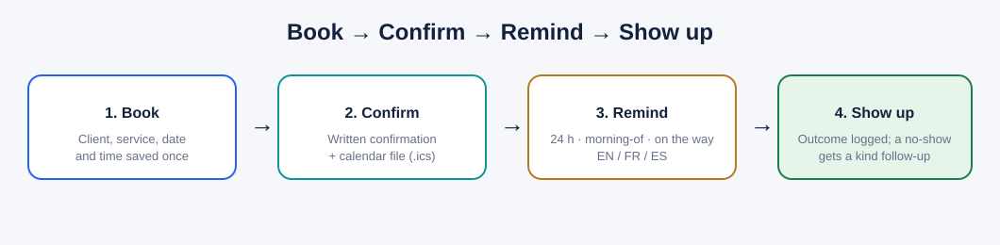
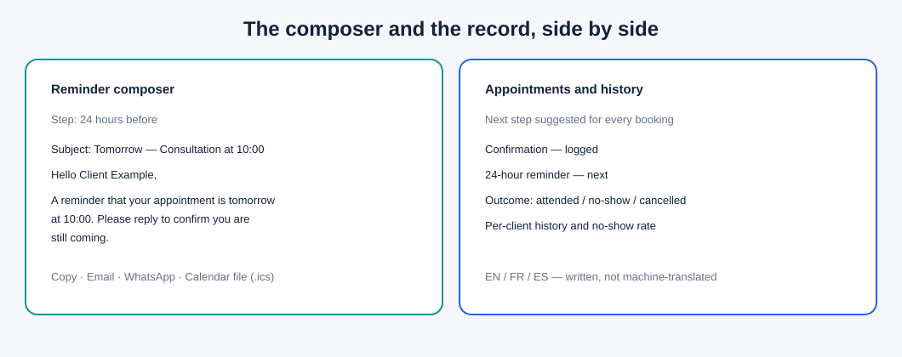

# Appointment Reminder Composer

**A trilingual appointment reminder kit for service businesses — local-first, no account, no subscription.**

**Live tool:** https://oviainc.github.io/appointment-reminder-composer/

## What we built

We built this composer for the moment every appointment-based business knows well: the slot is booked, the day is planned around it, and then the client simply does not come — most often because the appointment was forgotten, not refused.

With this tool, we:

- Save **clients and services once** — name, contact details, preferred language, service name and duration — and book each new appointment in a few taps
- Compose a **confirmation at booking**, written in the client's own language, with the date, time, place, and a way to reply and move the appointment instead of vanishing
- Follow the sequence that works — **confirmation, one-week check-in, 48-hour reminder, 24-hour reminder, morning-of reminder, on-the-way message** — each step written in English, French, and Spanish, ready to copy and send
- **Bring a distant booking back to mind, one week before**: a booking made weeks ahead is the easiest one to forget, and its plans are the most likely to have changed. One week before the appointment, a check-in in the client's language asks them to confirm the time still works, or to move it while a full week remains to refill the slot. The suggested next step surfaces this step exactly in its window — after the confirmation, before the 48-hour reminder takes over — and appointments booked inside that week simply skip it and go straight to the 48-hour rhythm
- **Use the 48-hour window, while a slot can still be refilled**: two days before the appointment, a reminder in the client's language asks them to confirm, cancel, or move — early enough that a freed slot can still go to someone else, instead of being discovered empty on the day. The suggested next step surfaces this step exactly in its window, after the confirmation and before the 24-hour reminder takes over
- **Send the message where the client actually reads it** — one click opens the composed message in email (addressed to the saved client email when we have it) or in WhatsApp; copy stays available for any other channel
- Download a **calendar file (.ics)** for every appointment, with reminders set a day and two hours before, so the appointment lands in the client's own calendar with its own alerts
- Keep a **message history on every appointment**: each message we compose is logged with its step and date, so we always know what was sent and when
- See the **suggested next step on every booking** — confirmation, one-week check-in, 48-hour, 24-hour, morning-of, on-the-way, or record the outcome — worked out from its time and the messages already logged, with that step pre-selected in the composer, so what to send next is decided before the moment arrives
- **Say it clearly when a booking moves or is cancelled**: a rescheduled appointment gets a ready-made message in the client's language stating both the old and the new time and asking them to confirm the new slot — the old time is kept on the record when the booking is moved, so the message never has to guess it — and a cancelled booking gets a cancellation message that closes the loop and invites the client to book again. Both are suggested first, before the normal rhythm resumes, and both are logged on the appointment like every other step
- **Record the outcome on every appointment** — attended, no-show, or cancelled, plus rescheduling in place — so the record reflects what actually happened, not what was planned
- **Log why a slot was missed, and whether it was refilled**: recording a no-show or a cancellation asks for the reason the client gave (forgot, work, travel — or none given, recorded as such), and the reason shows on the appointment. A missed slot that went to someone else — from the waitlist or a walk-in — is marked refilled on the appointment, and the dashboard counts the slots refilled beside the no-show rate, so the record shows what was recovered, not only what was lost
- **Record the client's confirmation when they reply**: the reminders ask the client to reply and confirm; one tap on the appointment records that confirmation, with the date. A confirmed badge shows on the booking, the suggested next step stops treating it as unanswered, and the per-client history counts confirmations alongside attendances and no-shows — so we know who answers, not only who arrives. Rescheduling clears the confirmation, because the new time needs a fresh answer
- **Work the still-to-confirm list, not the whole book**: the dashboard counts how many upcoming bookings are confirmed ahead, with the rate, and lists every upcoming booking that has not confirmed yet — when, client, service, contact, and whether the confirmation was sent — so the day-before follow-up calls go only to the clients who have not answered, the short list the current guides prescribe, instead of the whole book or nobody at all
- See **upcoming, today, attended, and no-show totals at a glance**, with the **no-show rate** worked out from completed appointments
- See **history by client**: every client's bookings, attendances, and no-shows in one view, with their no-show rate — so a repeat pattern is visible before the next slot is given away
- See **history by service**: every service's bookings, attendances, no-shows, and cancellations in one view, with its no-show rate and how many of its missed slots were refilled — so the pattern by service is visible too. A service that misses often is the one to protect first; a service that refills well is the one whose waitlist is working
- See **history by weekday**: every weekday's bookings, attendances, no-shows, and cancellations in one view, Monday to Sunday, with its no-show rate and how many of its missed slots were refilled — so the pattern by day is visible too. A weekday that misses often is the one to protect first with an extra 48-hour reminder, a deposit, or the most reliable bookings; a weekday that refills well is the one whose waitlist is working
- See **history by time block**: every time block's bookings, attendances, no-shows, and cancellations in one view — early morning before 09:00, morning 09:00–12:00, midday 12:00–14:00, afternoon 14:00–17:00, and evening from 17:00 — with its no-show rate and how many of its missed slots were refilled — so the pattern by time of day is visible too. A time block that misses often is the one to protect first with an extra 48-hour reminder, a deposit, or the most reliable bookings; a time block that refills well is the one whose waitlist is working
- See **history by lead time**: every lead time's bookings, attendances, no-shows, and cancellations in one view — same day, 1–3 days ahead, 4–7 days ahead, 8–14 days ahead, 15–30 days ahead, and over 30 days ahead, worked out from the booked-on date now saved with every appointment — with its no-show rate and how many of its missed slots were refilled — so the pattern by how far ahead a booking was made is visible too. Appointments saved before the booked-on date existed carry no lead time and are left out, rather than given one that was never recorded. A lead time that misses often is the one to protect first with the one-week check-in, an extra 48-hour reminder, a deposit, or the most reliable bookings; a lead time that refills well is the one whose waitlist is working
- **Act on the repeat pattern, targeted — not blanket**: the per-client record flags itself. At two no-shows a client carries a warning badge (one more miss and a deposit applies); at three or more, a deposit flag. For a flagged client, a new booking's suggested next step is the **deposit request** — a ready-made message in the client's language explaining that a deposit now holds their slot, that it comes off the bill in full when they come, and that it only stays with the business if the appointment is missed again without notice. Once the request is logged, the normal confirmation rhythm resumes. The policy lands on the few clients who earned it; everyone else books as usual
- **Fill a freed slot from the waitlist**: clients who wanted a slot and could not get one join a waitlist with the service they want and the times that suit them; when a cancellation or a gap opens a slot, we offer that exact slot with a ready-made message written in the client's language (English, French, or Spanish), send it by email or WhatsApp in one click, and log every offer on their entry — so a freed slot goes to someone already waiting instead of staying empty, and nobody is asked twice about the same opening
- **Follow up kindly after a no-show**: a first message soon after the missed slot, and a second two days later offering a new time — both written in the client's language, firm about the cost of the empty slot without closing the door
- **Thank the client after the visit — and book the next one**: when an appointment is marked attended, the suggested next step is a post-visit note in the client's language — thanking them for coming, inviting them to book the next appointment by reply, and asking for a few words about the visit. It is logged on the appointment like every other step, so the visit ends with the next booking already in motion, not with silence
- **State the cancellation policy where the client reads it**: when a policy is saved for the business, it travels with the confirmation, the 48-hour reminder, and the 24-hour reminder, under a label in the appointment language (English, French, or Spanish) — stated in the message itself, not remembered from an earlier conversation
- Export and import a **JSON backup** of everything

## Who we built it for

Salons, barbers, clinics, studios, consultants, trades, and small service teams who work by appointment — especially teams who serve clients in more than one language and are tired of losing booked slots to simple forgetting, and of rewriting the same reminders from scratch.

## Trilingual, properly

The interface switches between **English, Français, and Español**. More importantly, each appointment carries its own language: a client who receives French messages gets a French confirmation and French reminders, even if we work in English day to day. The message templates are written in each language — confirmation, the one-week check-in, 48-hour, 24-hour, morning-of, on-the-way, both post-no-show follow-ups, the deposit request, the rescheduled and cancellation messages, and the post-visit follow-up — not passed through word-for-word machine translation.

## How the moat works

- **Your data accumulates here.** Every client we save, every service in the library, and every appointment in the history makes the next booking faster. That growing, structured history is a switching cost no blank template can match.
- **Language depth is the niche.** Global scheduling tools often add languages as a thin translation layer. We wrote the full workflow — interface, confirmations, all the reminder steps, both follow-ups, and the deposit request — in English, French, and Spanish from the start.
- **The history compounds.** Every logged message and every recorded outcome builds a per-client record of who confirms, who comes, and who does not. That record drives the suggested next step on every booking and the per-client no-show rate — knowledge a blank template starts from zero on.
- **It embeds in the daily workflow.** Confirming, reminding, and following up are not one-off tasks; they are the daily rhythm of running a full calendar. A tool that sits in that rhythm stays.
- **Clients see it.** Every confirmation, reminder, calendar file, and follow-up a client receives came from here — counterparties discover the kit through the messages themselves.
- **The waitlist is demand on record.** Every client waiting for a slot is a name, a service, and a preferred time already captured, with every offer logged. When a slot frees, the business fills it from its own list instead of hoping the phone rings — and that list, like the client history, only exists because the business built it here.
- **The confirmation record is a work list too.** Confirmations were already counted per booking and per client; now they also sort the upcoming book into confirmed and still to confirm, with the confirmed-ahead rate on the dashboard — so the record tells the desk exactly who to call today, instead of leaving that list to memory.
- **The flag is part of the record too.** Repeat no-shows are counted from the outcomes already logged — no separate list to maintain, nothing to remember at the desk. The warning at two and the deposit flag at three are worked out from the same history that drives the reminders, so the consequence a guide recommends is the consequence the record actually applies.
- **The policy is part of the record too.** The cancellation policy saved for the business travels with the confirmation, the 48-hour reminder, and the 24-hour reminder, in the appointment's own language, so the terms were stated where the client read them — not remembered differently afterwards.
- **The one-week window is part of the rhythm too.** A distant booking is brought back to mind a week before it happens, while moving it still leaves a full week to refill the slot — and the check-in is logged on the appointment like every other step, so the record shows the client was asked long before the day, not only in the last two days. The lead-time view names which bookings need it most; this step is how the kit acts on that pattern.
- **The 48-hour window is part of the rhythm too.** A cancellation learned two days early can be refilled from the waitlist; one learned on the day cannot. The 48-hour reminder is logged on the appointment like every other step, so the record shows the client was asked while there was still time to act — and the suggested next step moves on to the 24-hour reminder once it has gone out.
- **A moved or cancelled booking is part of the record too.** Rescheduling now keeps the old time on the appointment, so the rescheduled message can state both times and ask the client to confirm the new slot, and a cancelled booking suggests its cancellation message before it is closed — so the change is confirmed in writing, in the client's language, instead of living only in the desk's memory.
- **The visit does not end at the door.** An attended appointment now suggests its own follow-up — a thank-you in the client's language that invites the next booking by reply and asks for a few words about the visit — and the note is logged on the appointment like every other step. The record that used to stop at "attended" now carries the rebooking too, so the next appointment is asked for while the visit is still fresh, not left to chance.
- **The missed-slot log is part of the record too.** Reasons and refills are recorded on the appointment itself, so the pattern — which services, times, or clients miss, and how often a freed slot is recovered — comes from the history already here, not from a separate log kept from memory.
- **The pattern by service is part of the record too.** Bookings, outcomes, and refills already recorded now roll up per service automatically, so the monthly review can see which service misses, which cancels, and which refills — and protect the fragile service first — instead of treating every empty slot as the same problem.
- **The pattern by weekday is part of the record too.** The same bookings, outcomes, and refills now roll up per weekday automatically, so the monthly review can see which day misses, which cancels, and which refills — and protect the fragile day first — instead of treating every weekday as the same risk.
- **The pattern by time block is part of the record too.** The same bookings, outcomes, and refills now roll up per time block automatically, so the monthly review can see which part of the day misses, which cancels, and which refills — and protect the fragile time block first — instead of treating every hour as the same risk.
- **The pattern by lead time is part of the record too.** The booked-on date saved with every appointment now rolls up with the same bookings, outcomes, and refills per lead time automatically, so the monthly review can see how far ahead the fragile bookings were made, which lead times cancel, and which refill — and protect the fragile lead time first — instead of treating a booking made a month ago as the same risk as one made this morning.

## Local-first and private

There is no account and no server. Everything is stored only in the browser's local storage on the device where it is used. Nothing is sent anywhere. Export a backup regularly, and import it on another device whenever needed.

## The managed version

This kit is the free, hands-on version of work we run as a managed service: client conversations answered, appointments scheduled and reminded automatically, and follow-up that happens without anyone having to remember it. The kit shows the rhythm; the managed version runs the rhythm for the business, across every booking, every day.

## Use it

Open the live tool, add the business details once, save the first client and service, and book the first appointment. No sign-up step stands in the way.

## Licence

MIT — see `LICENSE`.
